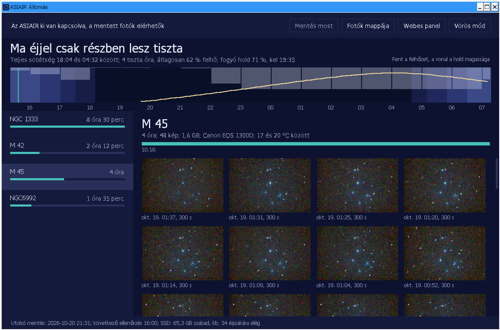
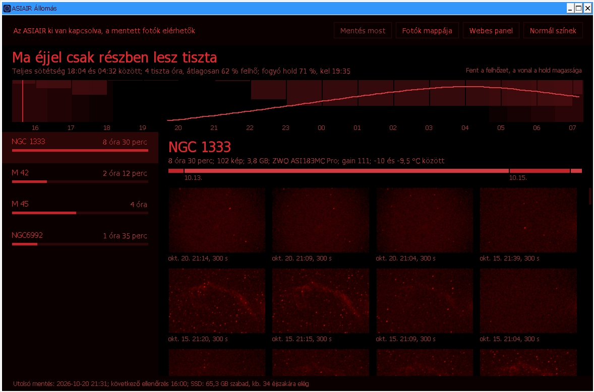

# ASIAIR Állomás

Windows-alkalmazás a picloudra mentett ASIAIR-fotókhoz: ma éjjeli ég, célpontok, galéria, mentés indítása, vörös mód.





## Frissítés

Induláskor és hatóránként megnézi a GitHub legújabb kiadását. Ha van újabb, megjelenik a „Frissítés erre” gomb: letölti, ellenőrzi, kicseréli magát és újraindul. Kézzel a jobb alsó sarokban lehet keresni.

Új kiadás: `./kiadas.sh X.Y.Z` a main ágról. A kiadás csomagjának neve `AsiairAllomas.exe` kell legyen.

## Fordítás

```
dotnet publish src/AsiairAllomas -c Release -r win-x64 --self-contained true -p:PublishSingleFile=true -p:IncludeNativeLibrariesForSelfExtract=true -p:EnableCompressionInSingleFile=true -p:DebugType=none -o publish
```

## Kapcsolat

HTTPS `asiair.park.lan`, tartalékként `192.168.1.185`, majd Tailscale `100.84.183.63`. Csak a beépített `park-ca.crt` gyökerét fogadja el. A jelszót DPAPI védi a `%APPDATA%\AsiairAllomas\beallitas.json` fájlban.

Billentyűk: F5 frissítés, Ctrl+R vörös mód, a galériában nyilak és Enter.
